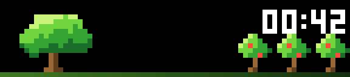
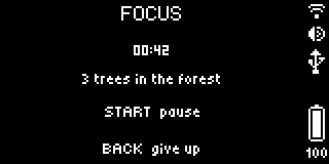
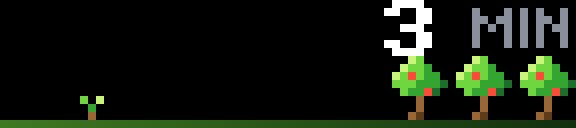
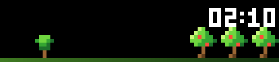
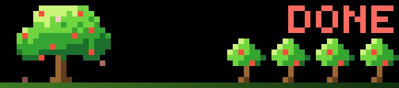

# Focus Timer

A focus session you can see. A sprout grows into a tree while you work. Give up and it wilts; finish and it blooms
and joins the forest of the sessions you finished today. An example app for the BUSY Bar, made to start from:
`busy-emulator create my-app --example focus-timer`.



The front display (72×16, color) faces the room: the tree, the time left, the forest.



The back display (160×80, gray) faces you: the state, the time, and what each control does now.

| Before the session | Young tree | Done |
| --- | --- | --- |
|  |  |  |

## Controls

| Control | What it does |
| --- | --- |
| Wheel | Before a session: its length, in steps of five minutes |
| Start (or a press of the wheel) | Begins the session; pauses it and goes on; after it, begins the break |
| Back | During a session: gives up, the tree wilts. Otherwise: leaves the app |

## Settings

On the bar's web page, under Apps → Focus Timer. The app reads them when it starts; after saving, the page offers
Restart.

| Setting | What it changes |
| --- | --- |
| Focus session, minutes | How long a session is when the app opens (1–180) |
| Break, minutes | After a finished session Start begins a break of this length; 0 turns breaks off |
| Tree | Apple (green), sakura (pink) or maple (orange): another animation file |
| Show the time left | Off: the front display is only the tree and the forest; the time stays on the back |
| Color of the time | The color of the time left on the front display |
| Sound at the end | A sound when a session or a break ends |
| Keep the forest overnight | Off: the forest starts again every day. On: every tree stays |

## How it is made

Things here that are worth copying into your own app:

- **The firmware animates, the app only names what to play.** A bar draws a whole frame from JavaScript about 3.5
  times a second. The tree is one `.anim` file (`src/animations/tree_*.anim`) with a section for each stage of growth
  (`grow0` … `grow11`, `bloom`, `wilt0` … `wilt11`); the app sends `{ type: "animation", section, loop: true }` and the
  firmware plays it 25 times a second.
- **The time counts down by itself.** It is a `countdown` element with the moment the session ends; the app sends it
  once. A countdown cannot stand still, and an element cannot change its type under the same id, so the paused time is
  a `text` element with another id.
- **One timer, twelve wake-ups.** The app wakes only when the tree reaches its next stage or the session ends
  (`wake()` in `src/main.ts`): between them it runs no code at all.
- **Only what changed is sent.** `shared/screen.ts` remembers what is on the displays by element id.
- **A short Back clears the app's screen on firmware 1.3.1.** After the Back that gives a session up, everything is
  drawn again (`screen.forget()`).
- **Settings are read with the bar's HTTP API**, `shared/settings.ts`. The template's own `loadValues()` reads a
  global that firmware 1.3.1 does not have.
- **The forest lives in `localStorage`**, one small write for each finished session: every write goes to flash.
- It runs in a 96 KiB heap (`heap_size_kib` in the manifest); it peaks near 72.

## Build and run

```sh
busy-emulator build                    # dist/<app id>.tgz
busy-emulator run                      # installs it on the emulated bar and starts it
busy-emulator logs                     # what the app printed, and why it ended if it did
busy-emulator screenshot --scale 8     # screenshots/front-1.png, and an enlarged copy to look at
```

`busy-emulator dev` does the first two again on every save. On a bar connected over USB the same project builds and
installs with `npm run build`, `npm run app:install` and `npm run app:run`.

The pictures in `docs/` show this example; the screenshots of your own app go to `screenshots/`, where the catalog's
checks look for them (`busy-emulator check`).

The pictures and animations are drawn by code: `examples/tools/make-art.py` in the emulator's repository.
